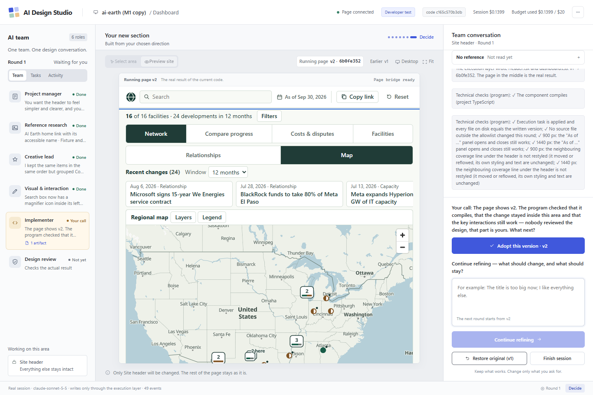
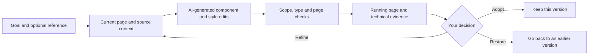
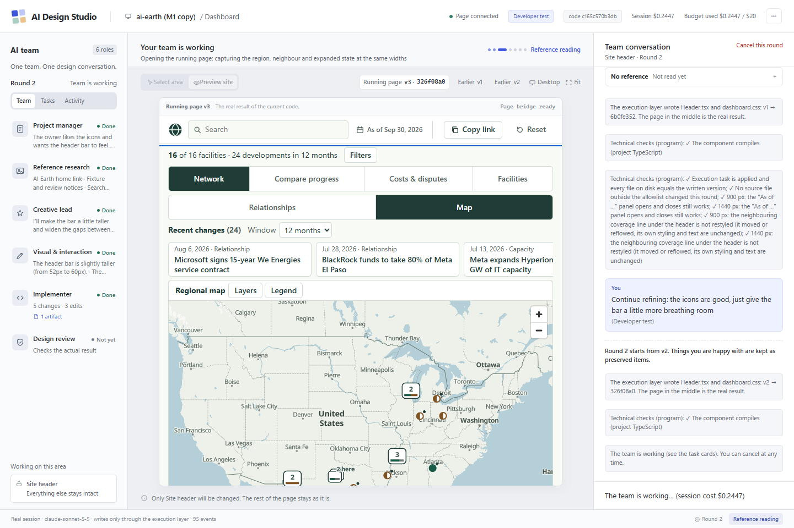

# AI Design Studio

**An AI design workbench for improving existing websites through visual context, natural-language feedback, and reversible code changes.**

A site already works; changing how it looks is still a coding task. You describe what you want, something gets rewritten, and the parts you were happy with quietly break. AI Design Studio keeps the running page, the design conversation, the execution activity and the version decisions in one place — and constrains edits through registered file boundaries, scope checks, and baseline validation.



*Round 1 of a developer test session on the validated header case. The badge in the top bar says `Developer test`; `code c165c570b3db` is the running code fingerprint.*

## What it does

- Pick a registered region of a running site and say what you want, optionally with a reference image.
- One LangGraph session turns that into real React/TypeScript and CSS edits in an isolated copy of the project.
- Every edit goes through an execution layer: allowlisted files only, baseline-hash check, atomic write, per-file diff.
- Before a result is offered: the selector scope is checked (a shared stylesheet may not be changed outside the region), the project's own TypeScript check must pass, before/after screenshots are captured at the same viewport, and the neighbouring region plus the region's key interaction are re-tested on the real page.
- You adopt the version, add one line of feedback for the next round, or restore an earlier version.

## Flow





*Round 2 of the same developer test session: one line of feedback — "the icons are good, just give the bar a little breathing room" — starts from the adopted version instead of from scratch.*

## Architecture

- **Workbench and target app** — React 19 + TypeScript on Vite. A single Node process serves the workbench UI, the HTTP API, the SSE stream and the target page, and probes the connection between them.
- **Orchestration** — LangGraph JS, a router ⇄ node graph that interrupts at every point where the product waits for a person (interpretation, direction, round decision) and resumes from the event log after a restart.
- **Facts** — an append-only JSONL event store is the only source of truth; rounds, versions, adoptions and restores are pure projections of it. Results that arrive after you have moved on are invalidated by epoch and generation, never written.
- **Model calls** — the Anthropic API (`claude-sonnet-5-5` in the validated runs) with zod-validated structured output, semantic validators per role, and per-call budget reservation and settlement in a cost ledger.
- **Writes and recovery** — an execution layer carried over from the previous phase (file allowlist, `expectedBase` hashes, atomic write, restore) plus per-project git snapshots, so any version can be put back byte-for-byte.
- **Evidence** — a short-lived headless Chrome over CDP with its own profile, started per capture and stopped afterwards; it only ever kills the process it started.
- **Version identity** — a fingerprint over every `runtime/`, `graph/`, `server/` and `chain/` module, printed at startup, exposed on `/api/state` and shown in the top bar, so you can always tell which code produced a result.

### About the six roles in the panel

The left panel shows six design responsibilities (project manager, reference research, creative lead, visual & interaction, implementer, design review). **These are not six independently running agents.** In the validated header configuration a single model call produces the whole round, and the cards say so — each one is labelled *"— in the same call"*. In the bundled example configuration the responsibilities run as separate calls inside one session. Design review is shown as *Not yet* when no review actually ran. Nothing here demonstrates that splitting the work across roles produces better results; that remains an open question.

## Run it

**Requirements** — Node ≥ 22 (validated on 24.13), Chrome (only for evidence screenshots), and an Anthropic API key for real model calls. Developed and validated on Windows 11.

```sh
cd prototypes/phase-02/studio
npm install
```

```powershell
# PowerShell — the key is read from the environment only; it is never written to the repo, the UI or the logs
$env:ANTHROPIC_API_KEY = "<your key>"
npm start
```

```sh
# bash
export ANTHROPIC_API_KEY="<your key>"
npm start
```

The workbench is on <http://127.0.0.1:5480> and the sample page on <http://127.0.0.1:5481>. Without a key, `npm run start:stub` runs the same product against a stub model (no API calls, clearly labelled in the UI, separate state directory) — useful for seeing the interface and the failure paths. `npm run check:version` tells you whether a running studio is still running the code on disk.

Useful environment variables: `WORKBENCH_PORT`, `TARGET_PORT`, `EVIDENCE_CDP_PORT`, `STUDIO_REGISTRY` (another project's regions), `STUDIO_PROJECT_ROOT` (the copy to write into), `STUDIO_STATE_DIR`, `STUDIO_LEDGER`, `CHROME`.

## Bundled example vs. validated case

| | Bundled example | Validated case |
|---|---|---|
| Project | a small sample site included here | AI Earth, a separate project of mine — **not included in this repo** |
| Region | "Opening hours panel" | Site header |
| Editable files | one CSS file | `Header.tsx` + `dashboard.css` |
| Runs from this repo | yes, with `npm start` | no — it needs that project's source |
| Source of the screenshots above | no | yes |

The screenshots and all the results below come from the validated case, which is **not** part of this repository. What you can run here is the bundled example: the same product, the same checks, a smaller region.

To point the studio at your own project, write a region registry by hand — regions are deliberately not auto-detected — and set `STUDIO_REGISTRY` and `STUDIO_PROJECT_ROOT`. [`examples/ai-earth-header.registry.json`](examples/ai-earth-header.registry.json) is the real registry used for the validated case: the editable files, the text and interactions that must survive, the neighbouring region, and what is forbidden.

## What has been validated

Three kinds of evidence, deliberately kept apart — none of them substitutes for another.

**1. Program checks (developer tests, real API).** One two-round session on the header case passed all 14 browser checks: the component and its styles really changed, the page still builds and renders, every label and accessible name survived, the key interaction and the neighbouring region still behave, only the two allowed files were touched, checks found no changes in the monitored non-header regions, feedback builds on the current version, a stale command writes nothing, and restore puts both files back. The first result arrived **62 seconds** after submitting, from **one** model call, at **US$0.2447** for the session, on code `c165c570b3db`. One run, not a benchmark.

**2. Owner adoption.** As the owner of that site I used the workbench for real: **3 sessions, 4 written versions, 4 adopted, 0 failed tasks, US$0.5239** of real API spend. In one session I adopted a result, gave one line of feedback, and adopted the next result too. "Adopted" means I chose to keep it — not that anyone else reviewed it.

**3. Commercial validation.** None. No other users, no user study, no revenue.

## Limits

- One hand-registered region per task; the validated scope is one header component and its stylesheet.
- Reference images are sent to the model, but no real owner session has used one — reference fidelity is unverified outside developer tests.
- Restore works in the checks; in real use it was never needed, so it has no field evidence.
- "The parts you liked stay the same" is enforced by program checks and judged by the owner; it has not been verified by an independent reviewer.
- No independent AI design review runs in the validated path.
- Animations, cross-region and whole-page edits, and new dependencies are blocked by design, not unimplemented by accident.
- **Not proven:** stable design quality across tasks, fewer rounds or less rework, any benefit from dividing work between roles, compatibility with other codebases, commercial demand.

## This snapshot

Product code as of commit `8579997` of the development repository; fingerprint **`c165c570b3db`** (15 modules under `runtime/`, `graph/`, `server/`, `chain/`) — recomputed here, identical to the version the results above were produced with.

Left out of this public snapshot: the separate project copy and its data, recorded sessions, model requests and responses, cost ledgers, service logs, internal planning and review documents, and unaccepted work in progress. The test suite and browser checks are also left out because they read those recorded sessions and that project copy. `package.json` was trimmed to the scripts that exist here; no runtime module was modified.

There is no hosted demo and no video walkthrough — the screenshots above are the only visual record.

Development phase 02 is closed; the next phase (stability and user burden) is on hold.
